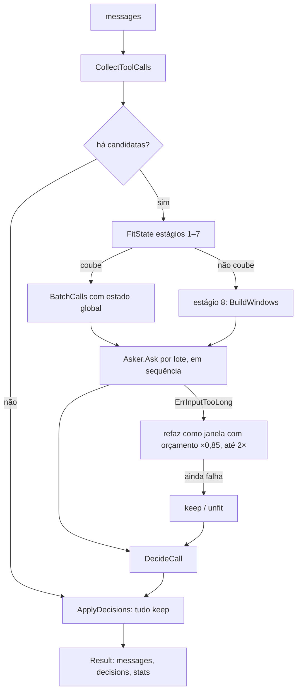

# 03 — Algoritmo

Porte fiel do algoritmo do [`fast-jev-compaction`](../references/fast-jev-compaction.md), com três acréscimos: orçamentos derivados do limite do Laya, o estágio 8 `windowed` e a política `unfit`. Tudo o que não está marcado como **[novo]** segue o original linha a linha.

## Visão do fluxo



## 1. Pareamento — `CollectToolCalls`

Idêntico ao original:

- Indexa todo `tool_result` por `tool_use_id` (guardando o índice da mensagem).
- Cada `tool_use` com resultado vira um `ToolCall` com id curto sequencial `t1`, `t2`, …
- `Pinned = isPinned(callIndex) || isPinned(resultIndex)`, onde `isPinned(i) = i == 0 || i >= total − preserveRecentMessages`.
- `ResultChars` = comprimento do texto do resultado, em caracteres (runas, não bytes — ver [ADR 0005](../adrs/0005-porte-fiel-do-algoritmo.md)).

## 2. Objetivo — `GoalFromMessages`

Se `options.Goal` vier vazio: últimos 3 prompts do usuário (papel `user`, texto não vazio, sem `toolResults`), cada um truncado a 500 caracteres, unidos por `\n`.

## 3. Estado

```go
type State struct {
    Context string         `json:"context"` // StateContext, texto fixo do original
    Goal    string         `json:"goal"`
    History []HistoryEntry `json:"history"`
}

type HistoryEntry struct {
    I         int        `json:"i"`
    Role      Role       `json:"role"`
    Text      string     `json:"text"`
    ToolCalls ToolCalls  `json:"tool_calls,omitempty"` // estruturadas OU uma linha por chamada
}
```

`ToolCalls` serializa como `[{id, tool, input, result}]` ou como `["t3 Read file_path=… → ok 4213ch", …]`, como no original. O resultado nunca entra no estado: só a nota `ok, 4213 chars (omitted)` / `error, …`.

O estado vai para o Laya como `laya.JSONState(json.Marshal(state))`. A serialização deve produzir as chaves na mesma ordem do original (`context`, `goal`, `history`; `i`, `role`, `text`, `tool_calls`), o que structs Go garantem.

## 4. Orçamentos [novo]

O limite efetivo `L` vem do bundle (`max_len = 1024` no `laya-multilingual-v1`) ou de um `InputTokenLimit` **menor** (o `laya-go` ignora valores acima do limite do bundle).

| Opção | Padrão | Derivação |
|---|---:|---|
| `maxRequestTokens` | 960 | `L − 64` (margem para tokens especiais e erro de estimativa) |
| `maxStateTokens` | 800 | ≈ 83% de `maxRequestTokens`, mesma proporção do original (25k/30k) |
| `windowCalls` | 2 | 4 perguntas por janela |
| `tokenScale` | 1,0 | multiplicador da estimativa; calibrado na Fase 3 |

Se o usuário só alterar `InputTokenLimit` (para menos, nunca acima de 1.024), os dois orçamentos são recalculados pelas fórmulas acima. Valores explícitos sempre prevalecem.

## 5. Estimativa de tokens

`EstimateTokens` é o porte exato da heurística do original (palavras: `1 + ⌊(len−1)/6⌋`; dígitos: `len/2`; outro símbolo: `0,9`; arredonda para cima), multiplicado por `tokenScale`. Ver [ADR 0007](../adrs/0007-estimativa-de-tokens-e-calibracao.md).

Custo de uma pergunta: `EstimateTokens(instructions) + questionOverheadTokens` (padrão 8, para o marcador de opção e o separador; calibrado na Fase 3). No original o custo era o JSON da pergunta; no Laya não há JSON de pergunta na entrada do modelo.

## 6. Estágios 1–7 — `FitState`

Idênticos ao original, com o mesmo nome de estágio em `stats.stateStage`:

| # | Estágio | Ação |
|---|---|---|
| 1 | `full` | inputs JSON até 1.000 caracteres |
| 2 | `inputs<=200`, `inputs<=60` | reconstrói com inputs menores |
| 3 | `texts abridged` | `abridge(text, 400, 150)`, não fixadas primeiro, mais antigas primeiro |
| 4 | `old messages collapsed` | texto de não fixadas vira `[… N chars omitted …]` |
| 5 | `old calls compacted` | chamadas de não fixadas viram uma linha cada |
| 6 | `old messages left out` | remove entradas não fixadas sem chamadas |
| 7 | `old calls merged` | funde sequências adjacentes só-chamada do mesmo papel |

Onde o original lançava erro, este porte devolve `ErrStateTooLarge` e o orquestrador passa ao estágio 8.

## 7. Lotes — `BatchCalls`

Igual ao original: orçamento de perguntas = `maxRequestTokens − stateTokens − 20`; acumula chamadas (2 perguntas cada) até estourar. Diferença: se uma única chamada não cabe, em vez de lançar erro devolve `ErrNoRoomForQuestions`, e o orquestrador passa ao estágio 8.

Os lotes são enviados **em sequência** (ver [ADR 0004](../adrs/0004-inferencia-in-process-com-laya-go-onnx.md)).

## 8. Estágio 8 `windowed` [novo]

Ver [ADR 0006](../adrs/0006-estagio-de-janela-por-lote.md) para a motivação.

### 8.1 Formação das janelas

As chamadas candidatas, na ordem do transcript, são divididas em janelas de `windowCalls` chamadas consecutivas.

### 8.2 Orçamento da janela

> **Nota (Fase 0).** No `laya-go` cada pergunta é uma sequência própria (`[CLS] noul question: … [SEP] <mask> false … <mask> true … [SEP] <estado> [SEP]`); o limite de 1.024 tokens vale por sequência, e o estado é recodificado para cada pergunta. As perguntas de uma janela, portanto, **não se somam**: o que limita é `estado + a maior pergunta (≈ 100–130 tokens com as descrições padrão das opções)`. A fórmula abaixo, que soma as perguntas, é a versão conservadora herdada do original e será refinada na Fase 3.

```
questionTokens(W) = Σ custo das 2 perguntas de cada chamada de W
stateBudget(W)    = maxRequestTokens − 20 − questionTokens(W)
```

### 8.3 Parte obrigatória

1. `context` e `goal`. O `goal` é truncado a no máximo 25% de `stateBudget(W)`. O `context` é `StateContext` seguido de uma frase só deste estágio, porque o texto original afirma que `history` é "the whole conversation so far", o que aqui é falso — e o modelo poderia ler a ausência de uma chamada posterior como "o arquivo nunca foi relido":

   ```
   WindowedStateNote = 'In this request `history` is an excerpt: it always contains the calls being asked about and the later calls that touch the same files or commands; other messages may be missing, so do not treat an absent message as never having happened.'
   ```
2. Para cada mensagem que contém uma chamada de W: entrada com `i`, `role`, texto abreviado (`abridge(text, 200, 100)`), as chamadas de W em forma estruturada (inputs ≤ 200 chars + nota do resultado) e as demais chamadas da mesma mensagem em uma linha.

### 8.4 Parte opcional (preenchimento guloso)

Enquanto couber em `stateBudget(W)`, acrescenta entradas nesta ordem de prioridade (cada item já no formato mais curto que ainda faz sentido):

1. **Mesmo recurso, depois**: chamadas posteriores a W cujo input tem o mesmo valor em alguma chave de recurso (`file_path`, `path`, `notebook_path`, `pattern`, `url`, `command`), em uma linha. É o sinal mais forte de obsolescência ("o arquivo foi relido/editado depois").
2. **Mensagens fixadas recentes**: texto abreviado `abridge(text, 400, 150)` e chamadas em uma linha.
3. **Demais chamadas posteriores**, uma linha cada, da mais próxima para a mais distante.
4. **Chamadas anteriores**, uma linha cada, da mais próxima para a mais distante.

Um item que não cabe é pulado (o próximo, menor, pode caber). O histórico final é ordenado por `i` antes de serializar, para o modelo ver a ordem real. Entradas de uma linha da mesma mensagem são agrupadas na entrada daquela mensagem.

### 8.5 Quando a parte obrigatória não cabe

Em ordem:

1. reconstrói a janela com inputs ≤ 60 chars e texto da mensagem colapsado (`[… N chars omitted …]`);
2. se W tem mais de uma chamada, divide em janelas de uma chamada e recomeça em 8.2 para cada uma;
3. se ainda não cabe, a chamada recebe `keep` com motivo **`unfit`** e não é perguntada.

## 9. Pedido ao modelo

```go
type Question struct {
    ID           string // "call_t3" | "result_t3"
    Instructions string // textos do original
}

type Asker interface {
    Ask(ctx context.Context, state State, questions []Question) (Answers, error)
}

type Answers struct {
    Probabilities map[string]float64 // P(true) por ID
    InputTokens   int                // Usage.InputTokens, para calibração
}
```

O adaptador Laya converte cada `Question` em `laya.NewNoulQuestion(QuestionID(ID), Instructions, "", "")` e usa `TrueProbability()`.

Validação da resposta (porte de `noulAnswer`): toda pergunta enviada precisa voltar com probabilidade finita em [0, 1]; caso contrário, `ErrMalformedAnswer`, que aborta a compactação (o hook faz fallback).

### 9.1 `ErrInputTooLong` [novo]

Indica que a estimativa ficou abaixo da contagem real. Para o lote ou janela afetado:

1. refaz como janela (estágio 8) com `maxRequestTokens × 0,85`;
2. repete uma segunda vez com `× 0,85` de novo;
3. se ainda falhar, as chamadas do lote recebem `keep`/`unfit`.

Cada nova tentativa incrementa `stats.retries`. Os demais lotes não são afetados.

## 10. Decisão — `DecideCall`

```
pinned                       → keep        (reason: pinned)
unfit                        → keep        (reason: unfit)       [novo]
keepResult ≥ keepThreshold   → keep        (reason: kept)
keepCall   ≥ keepThreshold   → drop_result (reason: result_dropped)
senão                        → drop_call   (reason: call_dropped)
```

`unfit` registra `keepCall = keepResult = 1`, como o original faz para chamadas sem resposta.

## 11. Reconstrução — `ApplyDecisions`

Idêntica ao original:

- `drop_call` remove o `tool_use` e o `tool_result` (e o `text` anexado ao `tool_use`).
- `drop_result` mantém `truncateHeadChars` caracteres + `\n[fast-laya-compaction truncated N chars of this tool result (error)?; re-run the tool if needed]`, só se o texto exceder `truncateHeadChars + 120`.
- Mensagem que fica sem texto, sem `toolUses` e sem `toolResults` é removida.

Acréscimo [novo]: cada mensagem de saída carrega `Source` (índice da mensagem de entrada) e `Unchanged` (verdadeiro se nada nela mudou); cada `toolUse`/`toolResult` mantido carrega `SourceIndex` (posição no bloco de origem). É o substituto da identidade de objeto do original, que se perde no HTTP ([ADR 0008](../adrs/0008-daemon-local-e-hook-ts-fino.md)).

## 12. Estatísticas

As do original (`messagesBefore`, `messagesAfter`, `charsBefore`, `charsAfter`, `calls`, `kept`, `resultsDropped`, `callsDropped`, `pinned`, `stateTokens`, `stateStage`, `requests`, `ms`) mais:

| Campo | Significado |
|---|---|
| `unfit` | chamadas mantidas sem consulta |
| `windows` | janelas montadas no estágio 8 (0 se não usado) |
| `retries` | tentativas extras por `ErrInputTooLong` |
| `inputTokensReported` | soma de `Usage.InputTokens` |
| `inputTokensEstimated` | soma das estimativas das mesmas requisições |

`stateStage` vale `windowed` quando o estágio 8 foi usado (`stateTokens` passa a ser o maior estado de janela). `ReductionRatio = (charsBefore − charsAfter) / charsBefore`.

## Invariantes

1. Nenhum `tool_use` mantido fica sem seu `tool_result`, e vice-versa.
2. Texto de usuário e assistente é byte a byte igual ao de entrada.
3. Mensagens com `Unchanged = true` são idênticas à entrada.
4. Chamadas `pinned` e `unfit` nunca são alteradas.
5. Nenhuma chamada é removida ou truncada sem probabilidades vindas do modelo.
6. A ordem relativa das mensagens é preservada.
