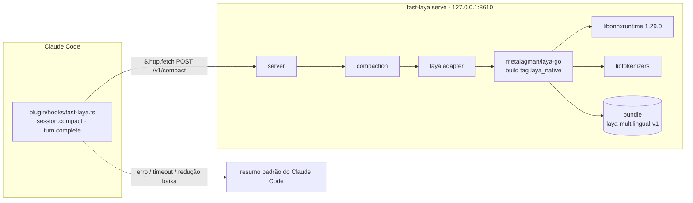
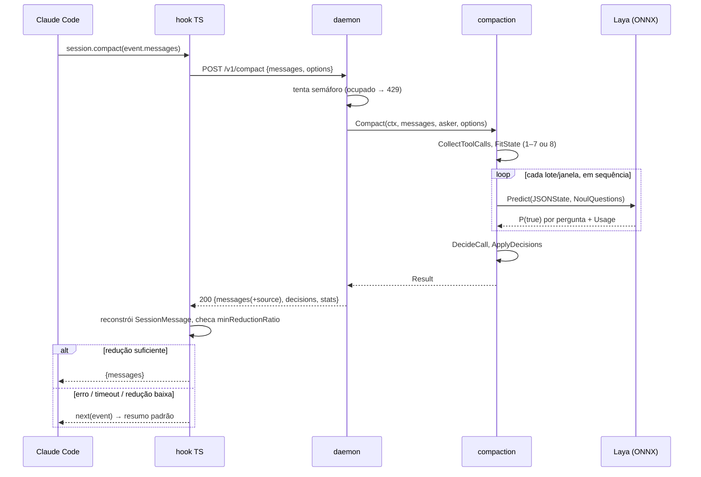

# 04 — Arquitetura

## Contexto



Nada sai da máquina: o único tráfego de rede é o loopback entre o hook e o daemon.

## Componentes

| Componente | Pacote | Depende de | Responsabilidade |
|---|---|---|---|
| Núcleo | `internal/compaction` | só biblioteca padrão | Algoritmo completo ([03](03-algoritmo.md)). Não faz I/O. Recebe um `Asker`. |
| Adaptador Laya | `internal/layaasker` | `compaction`, `laya-go` | Implementa `Asker`. Abre `Runtime`/`Model`, converte estado e perguntas, mapeia erros. Arquivo real com `//go:build laya_native`; arquivo stub sem a tag, que retorna `ErrNativeUnavailable`. |
| Laya falso | `internal/compaction/fakelaya` | `compaction` | `Asker` determinístico para testes: probabilidades por regra (por id, por ferramenta, ou função), registra requisições, simula `ErrInputTooLong` e erros. |
| Servidor | `internal/server` | `compaction`, `net/http` | Rotas, validação, códigos de erro, semáforo de uma compactação, `readyz`. |
| Configuração | `internal/config` | `flag`, `os` | Flags + variáveis de ambiente, padrões e validação ([07](07-configuracao.md)). |
| CLI | `cmd/fast-laya` | todos | Subcomandos `serve`, `compact`, `version`, `doctor`. |
| Plugin | `plugin/` | Claude Code function hooks | Hook TS fino ([06](06-plugin-claude-code.md)). |
| Provisionamento | `scripts/`, `Dockerfile` | — | ([08](08-provisionamento.md)). |

### Por que o núcleo não conhece o Laya

O `Asker` é a mesma costura que o original tinha com `JevAsker`. Mantê-la permite:

- testar todo o algoritmo sem cgo, sem bundle e sem ONNX (`go test ./...` em qualquer máquina);
- trocar o backend no futuro (por exemplo, o cliente HTTP do `lengoman/laya-go`) sem tocar no algoritmo.

## Layout planejado do repositório

```
fast-laya-compaction/
├── go.mod                         # module github.com/fsvxavier/fast-laya-compaction
├── cmd/fast-laya/main.go
├── internal/
│   ├── compaction/
│   │   ├── types.go               # Message, ToolUse, ToolResult, ToolCall, Decision, Options, Result
│   │   ├── options.go             # padrões, ResolveOptions, derivação dos orçamentos
│   │   ├── tokens.go              # EstimateTokens
│   │   ├── calls.go               # CollectToolCalls, isPinned, GoalFromMessages
│   │   ├── state.go               # State, HistoryEntry, FitState (estágios 1–7)
│   │   ├── window.go              # estágio 8: BuildWindows
│   │   ├── batch.go               # QuestionsFor, BatchCalls
│   │   ├── decide.go              # DecideCall
│   │   ├── apply.go               # ApplyDecisions, MessageChars, ReductionRatio
│   │   ├── compact.go             # Compact (orquestração, retries, stats)
│   │   ├── errors.go
│   │   ├── fakelaya/fakelaya.go
│   │   └── testdata/              # golden files por estágio
│   ├── layaasker/
│   │   ├── asker_native.go        # //go:build laya_native
│   │   └── asker_stub.go          # //go:build !laya_native
│   ├── server/
│   └── config/
├── .claude-plugin/marketplace.json  # na raiz: `marketplace add owner/repo` procura aqui; aponta source ./plugin
├── plugin/
│   ├── .claude-plugin/plugin.json
│   ├── hooks/fast-laya.ts
│   ├── hooks/hooks.json
│   ├── types/claude-code.d.ts     # gerado pelo Claude Code
│   └── tests/hook.test.ts
├── scripts/provision.sh
├── testdata/transcripts/          # transcripts sintéticos para --report
├── Dockerfile
├── Makefile
└── Project/                       # esta documentação
```

Segue as convenções `cmd/` + `internal/`: nada é exportado como biblioteca pública na v1. Se surgir demanda por uso como biblioteca, `internal/compaction` sobe para `compaction/` numa versão posterior.

## Sequência de uma compactação



## Ciclo de vida do daemon

1. Lê a configuração; recusa endereço que não seja loopback sem `--allow-remote`.
2. Define `ORT_DISABLE_TELEMETRY=1`.
3. Começa a escutar **antes** de carregar o modelo: `/healthz` responde 200 e `/readyz` 503 durante o carregamento (que pode levar segundos).
4. `laya.NewRuntime` → `OpenModelDir(LAYA_BUNDLE_DIR, ModelOptions{QueueCapacity: 0, InputTokenLimit: …})`. Bundle inválido ou bibliotecas ausentes → log de erro e saída com código ≠ 0.
5. `/readyz` passa a 200.
6. Em `SIGINT`/`SIGTERM`: para de aceitar conexões, espera a compactação em curso (até 30 s), `Model.Close`, sai.

## Concorrência

O `laya-go` atende uma inferência por vez. O daemon atende **uma compactação por vez** via semáforo não bloqueante; uma segunda requisição recebe `429` na hora em vez de esperar, porque o hook tem timeout e prefere o fallback a uma espera longa. Dentro de uma compactação, os lotes vão em sequência. `QueueCapacity: 0` no `Model`, já que o próprio daemon garante a serialização.

O cancelamento do `context` da requisição (cliente desistiu, timeout do hook) interrompe a compactação entre inferências.
